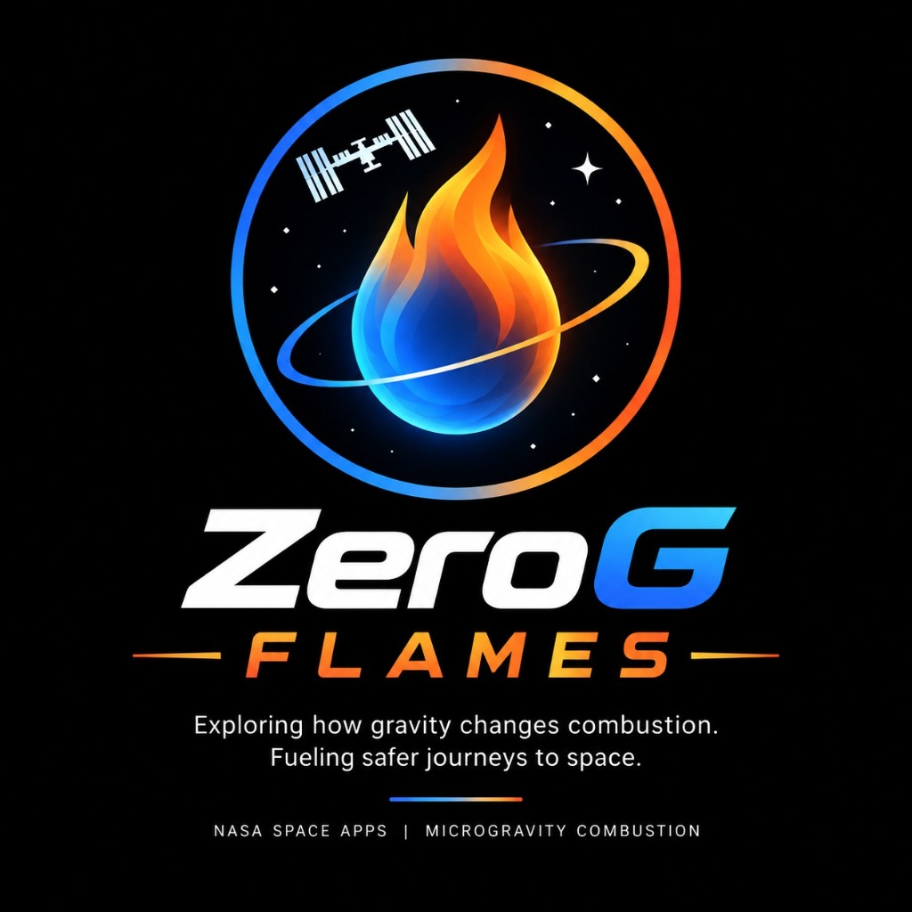

# ZeroG Flames 🚀🔥

**Interactive Microgravity Combustion Simulator & Educational Laboratory**  
*Developed for NASA Space Apps Challenge 2026*



---

## 🌌 Overview & Core Research Question

> **"How does reduced gravity affect oxygen transport and combustion, and what could this mean for spacecraft fire safety?"**

On Earth, gravity produces buoyancy because hot combustion products are substantially less dense than cool surrounding air. This density gradient generates **natural convection**, which sweeps hot exhaust upward and pulls fresh oxygen-rich air into the flame base.

In microgravity (such as aboard the International Space Station or exploration spacecraft), buoyancy-driven natural convection becomes negligible. Heat and species transport shift from being **buoyancy-dominated** to **diffusion-dominated** (or governed by forced cabin ventilation).

```text
Gravity (g) 
  → Buoyancy Force (F_b) 
  → Natural Convection 
  → Species (O₂/Fuel) & Heat Transport 
  → Combustion Behavior & Flame Morphology 
  → Spacecraft Fire Safety Implications
```

---

## 🚀 Key Features

1. **Interactive Zero-G Laboratory**:
   - Continuous Gravitational Acceleration Slider ($0.00\text{ g} \to 3.00\text{ g}$) with dual readouts ($g$ and $\text{m/s}^2$).
   - Planetary presets: **Earth Surface (1.0g)**, **Mars (0.38g)**, **Lunar Surface (0.165g)**, **Orbital Microgravity ($10^{-4}$g)**, and **NASA Artemis Cabin (34% O₂ @ 56 kPa)**.
   - Independent controls for Oxygen concentration ($2\% \to 40\%$), Ambient Pressure ($20 \to 200\text{ kPa}$), and Forced Cross-Ventilation ($-1.5 \to +1.5\text{ m/s}$).
   - Fuel selector (Methane $\text{CH}_4$, Generic Hydrocarbon, Ethanol Vapor).
2. **Multi-Field 2D Scientific Visualizer**:
   - **Flame Glow View**: Photorealistic emissive mapping showing teardrop buoyant plume vs calm spherical reaction shell.
   - **Temperature Field Heatmap**: $T(x,y)$ with calibrated Kelvin colorbar.
   - **Oxygen Depletion Field**: $Y_{\text{O}_2}(x,y)$ spatial consumption.
   - **Fuel Distribution Field**: $Y_F(x,y)$ burner plume.
   - **Reaction Rate Front**: $\omega(x,y)$ Arrhenius flame front.
   - **Velocity Field**: Superposed vector streamlines representing $\mathbf{u}_{\text{total}} = \mathbf{u}_{\text{forced}} + \mathbf{u}_{\text{buoyancy}}$.
3. **Timeline Scrubbing & Playback**:
   - Time-stepping animation playback and frame scrubbing.
4. **Earth vs. Microgravity Compare Mode**:
   - Side-by-side split screen visualizer with comparative quantitative delta table.
5. **Interactive Experiments Suite**:
   - **Gravity Sweep**: Automated sweep plotting buoyant velocity and peak temperature against gravity.
   - **Extinction Boundary Mapping**: Sweep finding the Limiting Oxygen Index (LOI) where combustion quenches.
   - **Microgravity + Ventilation Sweep**: Evaluates forced cross-flow velocity vs. reaction rate, demonstrating that ventilation governs transport when buoyancy vanishes.
   - **Data Export**: Export complete 2D simulation fields and scalar diagnostics to JSON or CSV.
6. **Educational Science & Safety Hubs**:
   - Illustrated guides on buoyancy, chemiluminescence vs soot incandescence, solid fuel pyrolysis vs gaseous fuels, cool flames (NASA FLEX ISS heritage), and spacecraft fire safety.

---

## 🧮 Governing Physical Model & Equations

ZeroG Flames implements a coupled 2D advection-diffusion-reaction conservation system:

### 1. Oxygen Species Transport
$$\frac{\partial Y_{\text{O}_2}}{\partial t} + \mathbf{u}\cdot\nabla Y_{\text{O}_2} = D_{\text{O}_2}\nabla^2 Y_{\text{O}_2} - s_{\text{O}_2}\omega$$

### 2. Fuel Species Transport
$$\frac{\partial Y_F}{\partial t} + \mathbf{u}\cdot\nabla Y_F = D_F\nabla^2 Y_F - \omega$$

### 3. Energy Equation (Temperature)
$$\frac{\partial T}{\partial t} + \mathbf{u}\cdot\nabla T = \alpha\nabla^2 T + \frac{Q_c \omega}{\rho c_p} - h_{\text{loss}}(T - T_{\text{amb}}) - \frac{\epsilon \sigma_{\text{SB}}}{\rho c_p L_{\text{rad}}}(T^4 - T_{\text{amb}}^4)$$

### 4. Arrhenius Chemical Kinetics
$$\omega = A \cdot Y_F \cdot Y_{\text{O}_2} \cdot \exp\left(-\frac{E_a}{R \cdot \max(T, T_{\text{cutoff}})}\right) \cdot \Phi_{\text{LOI}}$$

### 5. Buoyancy Acceleration & Velocity Superposition
$$\mathbf{u}_{\text{total}} = \mathbf{u}_{\text{forced}} + \mathbf{u}_{\text{buoyancy}}$$
$$F_b = \rho g \beta (T - T_{\text{amb}})$$

---

## 📁 Repository Structure

```text
NASA/
├── backend/
│   ├── app/
│   │   ├── main.py              # FastAPI app and static web server
│   │   ├── api/
│   │   │   ├── simulation.py    # Simulation, comparison, sweep, ventilation endpoints
│   │   │   └── presets.py       # Planetary presets and fuel database
│   │   ├── physics/
│   │   │   ├── grid.py          # 2D computational domain
│   │   │   ├── buoyancy.py      # Boussinesq body force and flow field
│   │   │   ├── oxygen.py        # Oxygen transport solver
│   │   │   ├── fuel.py          # Fuel transport solver
│   │   │   ├── heat.py          # Energy and temperature solver
│   │   │   ├── reaction.py      # Arrhenius combustion kinetics
│   │   │   ├── metrics.py       # Scalar metrics and state classifier
│   │   │   └── solver.py        # Coupled 2D solver orchestrator
│   │   ├── models/
│   │   │   ├── inputs.py        # Pydantic request models
│   │   │   └── outputs.py       # Pydantic response models
│   │   └── data/
│   │       ├── fuels.json       # Fuel thermodynamic properties
│   │       └── environments.json # Environment presets
│   ├── tests/
│   │   ├── test_diffusion.py    # Diffusion smoothing tests
│   │   ├── test_buoyancy.py     # Buoyancy gravity scaling tests
│   │   ├── test_reaction.py     # Chemical kinetics tests
│   │   ├── test_solver.py       # Full coupled integration tests
│   │   ├── test_api.py          # FastAPI endpoint tests
│   │   ├── test_live_server.py  # Live server integration test
│   │   └── run_all_tests.py     # Automated test suite runner (26 tests)
│   └── requirements.txt
├── frontend/
│   ├── src/
│   │   ├── components/          # React components (Navbar, Sliders, FlameViewer, etc.)
│   │   ├── pages/               # Views (Home, Laboratory, Compare, Science, Safety)
│   │   ├── services/            # simulationAPI.ts
│   │   ├── types/               # TypeScript simulation interfaces
│   │   ├── utils/               # Formatting utilities
│   │   ├── App.tsx
│   │   └── main.tsx
│   ├── index.html
│   ├── vite.config.ts
│   ├── tsconfig.json
│   └── package.json
├── static/
│   ├── index.html               # Main Web UI Application (served directly by FastAPI)
│   ├── css/
│   │   └── styles.css           # Mission-control scientific styling
│   ├── js/
│   │   ├── app.js               # Application state and controller
│   │   ├── api.js               # Backend API client
│   │   ├── renderer.js          # 2D Canvas field visualizer
│   │   └── charts.js            # Scientific charting engine
│   └── assets/
│       ├── zerog-team-logo.jpg  # ZeroG Flames Team Logo
│       └── nasa-space-apps-logo.svg # NASA Space Apps Challenge Logo
├── .env.example
├── BASELINE.md
└── README.md
```

---

## 🛠️ Installation & Running Locally

### 1. Prerequisites
- Python 3.10+
- Modern Web Browser (Chrome, Edge, Firefox, Safari)

### 2. Setup & Start Backend + Web UI
```bash
# Install dependencies
pip install -r backend/requirements.txt

# Run the FastAPI server (serves both API and Web UI)
python -m uvicorn backend.app.main:app --host 127.0.0.1 --port 8000 --reload
```

### 3. Open the Application
Open your browser and navigate to:
```text
http://127.0.0.1:8000
```

---

## 🧪 Automated Testing

Execute the full physics and API test suite:
```bash
python backend/tests/run_all_tests.py
```

All 26 sanity, physics, and integration tests validate:
- Oxygen and thermal diffusion smoothing
- Buoyancy vanishing at $0\text{g}$ and scaling monotonically with gravity
- Forced cross-ventilation operating independently of gravity
- Arrhenius chemical ignition and oxygen flammability cutoff
- Coupled 2D solver stability across all fuels (methane, hydrocarbon, ethanol vapor)
- Bidirectional forced airflow (+1.0 m/s and -1.0 m/s)
- Pressure variations (Artemis 56 kPa vs Terrestrial 101.3 kPa)
- Conservation and physical boundedness of all fields ($T \in [T_{\text{amb}}, 2400]$, species $\in [0, 1]$)
- FastAPI endpoints (`/api/simulate`, `/api/compare`, `/api/sweep`, `/api/extinction`, `/api/ventilation`, `/api/metadata`, `/api/presets`, `/api/fuels`)
- Static assets and SPA routing fallback


---

## 📜 Scientific Disclaimers & Assumptions

ZeroG Flames is a **reduced-order educational combustion model** designed for intuitive visual exploration of buoyancy-driven vs. diffusion-dominated transport. It is not intended for certified aerospace engineering CFD validation.
